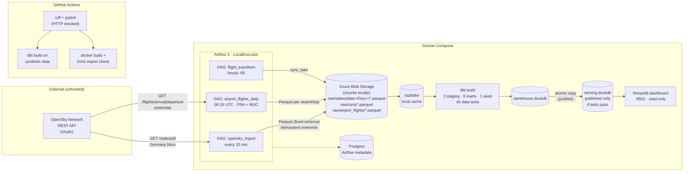

# ✈️ Flight Operations Data Pipeline

**Live ADS-B data from the OpenSky Network → Airflow → Azure Blob Storage → dbt (models + tests) → dashboard. Runs in Docker, verified by GitHub Actions.**

[](https://github.com/chiranjeev89/opensky-flight-pipeline/actions/workflows/ci.yml)
   

<!-- Add a screenshot after the first live run: docs/img/dashboard.png -->

---

## 1. Problem

Airports and airlines need reliable, up-to-date traffic data. Air traffic data is public: every airliner broadcasts its position over ADS-B. Raw, though, it is hard to use. It arrives as an unlabelled array of 17 numbers per aircraft, with missing positions, padded callsigns and SI units. It changes every few seconds, and the API has a daily credit budget.

I worked 2+ years on predictive modelling of aircraft systems, and models like that need data that is **reliable, tested and on time**. So this project answers an engineering question rather than an analysis one:

> *Can I build a pipeline that collects live flight data around the clock, never publishes bad data, stays inside the free API budget, and proves its own health with numbers?*

The questions the data then answers:
- How many aircraft are over Germany each hour, and when is the peak?
- **How many flights use Frankfurt (FRA) and Munich (MUC) each hour and day, and what are their busiest routes?**
- What share of observations are climb, cruise, descent or on the ground?
- Which registration countries fly over Germany?
- **How healthy is the pipeline itself?** (completeness, latency, data quality)

## 2. Architecture



Static image for slides/LinkedIn: [docs/img/architecture.png](docs/img/architecture.png)

| Layer | Tech | Why (full reasoning in [docs/DECISIONS.md](docs/DECISIONS.md)) |
|---|---|---|
| Ingest | Python + `requests`, OAuth2 client credentials | Only auth flow OpenSky supports since March 2026 |
| Orchestration | Apache Airflow 3 | Retries, scheduling and a UI; used in most German data-engineering roles |
| Storage | Azure Blob, Parquet, Hive partitions | Cheap, durable, columnar; Azurite emulates it locally for free |
| Transform | dbt + DuckDB | SQL with lineage, tests and docs; €0 compute; runs in CI |
| Serving | Streamlit | Python, in git, one container |
| Packaging/CI | Docker Compose, GitHub Actions | One-command start; every push proven |

## 3. Measure: what I track, and how

The pipeline measures itself. Every ingest run writes a metrics row (`raw/runs/`), and two dbt marts turn those rows into numbers:

| Metric | Source | Definition |
|---|---|---|
| **Schedule completeness** | `fct_pipeline_health` | runs landed ÷ 144 expected per day |
| **API latency avg / p95** | `fct_pipeline_health` | time for `/states/all`, measured in the task |
| **Credits remaining** | `fct_pipeline_health` | from the `X-Rate-Limit-Remaining` header |
| **Rows / storage per day** | `fct_pipeline_health` | state vectors and MB of Parquet |
| **% missing position / callsign** | `fct_data_quality` | quality of the raw feed |
| **Duplicates removed** | `fct_data_quality` | raw rows − cleaned rows |
| **Data tests passed** | `dbt build` | 45 data tests (35 generic + 10 singular) on every hourly run |
| **Airport movements per day** | `fct_airport_daily` | arrivals + departures at FRA and MUC, with % unknown origin/destination |
| **Airport data freshness** | `assert_airport_data_is_fresh` | newest complete airport day ≤ 3 days old (warning) |
| **Credit budget** | design | `/states`: 144 runs × 2 credits = **288/day = 7% of quota**; `/flights`: 4 calls/day (separate bucket) |

Reproduce every number with one command: `make measure` (runs [scripts/measure_pipeline.py](scripts/measure_pipeline.py)).

## 4. Results (with numbers)

> ⚠️ **Status: SYNTHETIC verification run (2026-10-28).** The numbers below come from 72 h of generated data pushed through the *real* serializer and dbt project. They prove the pipeline logic works. **Replace this table with live numbers after 7 days** (`make measure`) and change this note to "Live, <dates>".

| Metric | Value |
|---|---|
| Days collected | 4 (72 h) |
| Ingest runs landed | 433 |
| Schedule completeness (full days) | 100.0% |
| State vectors stored | 132,461 |
| Storage used | 11.28 MB Parquet (~26 KB per snapshot) |
| API latency avg / p95 | 514 ms / 911 ms *(simulated)* |
| Unique aircraft seen | 400 |
| Peak airborne aircraft in one hour | 275 |
| Rows missing position | 2.09% |
| dbt build | **58 / 58 PASS** (12 models, 1 seed, 45 tests) |
| Unit tests | 28 passed (+1 DAG import test run in CI Docker job) |
| **Negative test**: injected impossible snapshot (98,000 ft, 900 m/s, lat/lon swapped) | **systemic-glitch test FAILS → 18 downstream nodes SKIPPED → nothing published** ✅ |
| **Real-world glitch handling** (found in live data, BUG-009) | 2 transponder glitches (> 750 kt) flagged and excluded, counted in `implausible_rows`, publish continues ✅ |

**Airports (synthetic verification, 3 days):** FRA ≈ 1,040 and MUC ≈ 790 movements/day; busiest routes LHR→FRA, FRA→LHR, MUC→FRA. A FRA→MUC flight appears in both airports' feeds and is counted **once** in `fct_routes` (tested). Live numbers replace these after the collection week.

## 5. Why it works

1. **Bad data cannot reach the dashboard.** `publish` runs only after `dbt build` succeeds. The negative test above proves it: one corrupt row stopped the whole publish, and the dashboard kept the last good data.
2. **Retries can't duplicate data.** Blob names are deterministic (`states_<snapshot_time>.parquet`) and uploads overwrite, and staging also dedupes on `(icao24, snapshot_ts)`.
3. **Raw data is never modified (ELT).** A cleaning bug is fixed by re-running dbt. That matters because a live API can't be re-fetched later.
4. **It fails loudly, not silently.** A fixed Parquet schema means a type change errors. Physical-limit tests (altitude, speed, bounding box) catch the classic swapped-index bug, and 429 is treated as "skip", not "retry and spam".
5. **It respects the budget by design.** The bounding box was chosen for its credit tier (≈71 sq° → 2 credits), and a unit test fails if someone widens it.
6. **No lock fights.** dbt writes `warehouse.duckdb` and the dashboard reads an atomically swapped `serving.duckdb`.
7. **Airport data that can be re-fetched is re-fetched.** Unlike live positions, OpenSky's flight history is available later, so the daily airport DAG uses `catchup`: days missed while the laptop was off fill in automatically.

## 6. What I'd improve

| Next step | Why |
|---|---|
| Incremental dbt models by `snapshot_hour` | Staging rescans all Parquet each hour, the first scaling limit ([FAILURE.md](docs/FAILURE.md)) |
| Sync only the last N days of partitions | `list_blobs` slows down as files pile up (~52k/year) |
| Alerts via `on_failure_callback` → Slack/email | Failures are visible only in the Airflow UI today |
| Managed Identity / SAS token instead of an account key | The connection string gives full account access ([THREAT.md](docs/THREAT.md) T-03) |
| gitleaks + Actions pinned by SHA in CI | Supply-chain and secret hygiene |
| Trajectory-based flight phases (1-min polling, ≤25 sq° box around FRA = 1 credit) | Snapshot phases can misclassify single noisy points |
| Full airport reference data (OurAirports) instead of the 54-airport seed | Every route gets a readable name, not only the common ones |
| Airport punctuality (compare with published schedules) | ADS-B gives actual times only; delays need schedule data |
| Real Azure deployment (Container Apps + Storage) | Moves cloud from emulated to production |

## 7. Run it

**Prerequisites:** Docker Desktop, Git, a free [OpenSky account](https://opensky-network.org) → Account → *API client* (client id + secret).

```bash
git clone https://github.com/chiranjeev89/opensky-flight-pipeline && cd opensky-flight-pipeline
cp .env.example .env            # paste OPENSKY_CLIENT_ID / OPENSKY_CLIENT_SECRET
docker compose up -d --build    # Airflow  http://localhost:8080  (no login locally)
                                # Dashboard http://localhost:8501
```
The first ingest lands within 10 minutes, and the first dashboard data appears after the next `:05` past the hour. Airport arrivals/departures appear after the daily 06:15 UTC run (it also fills in all earlier days automatically).

**Without Docker or credentials (2 minutes):**
```bash
pip install -r requirements-dev.txt -r requirements-dashboard.txt
make sample && make dbt && make measure
SERVING_DB_PATH=data/lake/serving.duckdb streamlit run dashboard/app.py
```

**Stop, resume, where the data is stored:** see [docs/OPERATIONS.md](docs/OPERATIONS.md).

**Use real Azure instead of Azurite:** put your storage account connection string in `AZURE_STORAGE_CONNECTION_STRING` in `.env`. No code changes are needed.

## 8. Repo map

```
src/flightpipe/     opensky_client.py · transform.py · storage.py · config.py   (all logic, unit-tested)
airflow/dags/       opensky_ingest.py · flight_transform.py · airport_flights_daily.py   (wiring only)
dbt/                models/staging · models/marts · seeds/airports.csv · tests · macros
dashboard/app.py    Streamlit
scripts/            generate_sample_data.py · measure_pipeline.py · inject_bad_snapshot.py
tests/              pytest (HTTP mocked)
docs/               engineering record (below)
```

## 9. Engineering record

Every decision in this repo is written down so I can defend it at a whiteboard:

| Question a reviewer asks | Answered in |
|---|---|
| Why X instead of Y? | [DECISIONS.md](docs/DECISIONS.md), [ALTERNATIVES.md](docs/ALTERNATIVES.md) |
| What if someone acts maliciously? | [THREAT.md](docs/THREAT.md), [CONSTRAINTS.md](docs/CONSTRAINTS.md) |
| What data structure, and why? | [DATA.md](docs/DATA.md), [FLOW.md](docs/FLOW.md) |
| Where does it fail? | [FAILURE.md](docs/FAILURE.md), [TESTING.md](docs/TESTING.md), [ROLLBACK.md](docs/ROLLBACK.md) |
| One-page brief | [defense/DEFENSE-flight-pipeline.md](docs/defense/DEFENSE-flight-pipeline.md) |

Also: [OPERATIONS](docs/OPERATIONS.md) · [HANDOVER](docs/HANDOVER.md) · [ASSUMPTIONS](docs/ASSUMPTIONS.md) · [DEPENDENCIES](docs/DEPENDENCIES.md) · [features/](docs/features) · [bugs/](docs/bugs)

---
Data: © [The OpenSky Network](https://opensky-network.org), used under their terms for non-commercial research. *Matthias Schäfer et al., "Bringing Up OpenSky: A Large-scale ADS-B Sensor Network for Research", IPSN 2014.*
Author: Chiranjeev Sharma · M.Sc. Data Science · B.E. Aerospace Engineering
