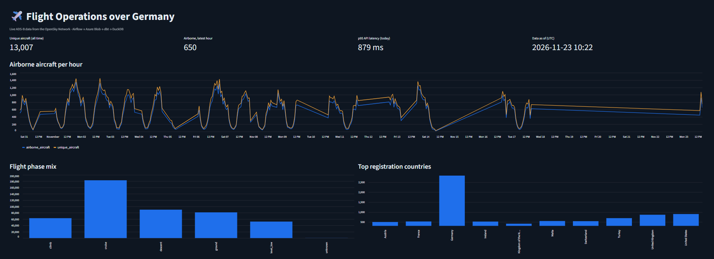
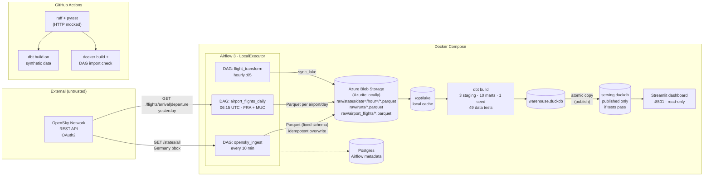
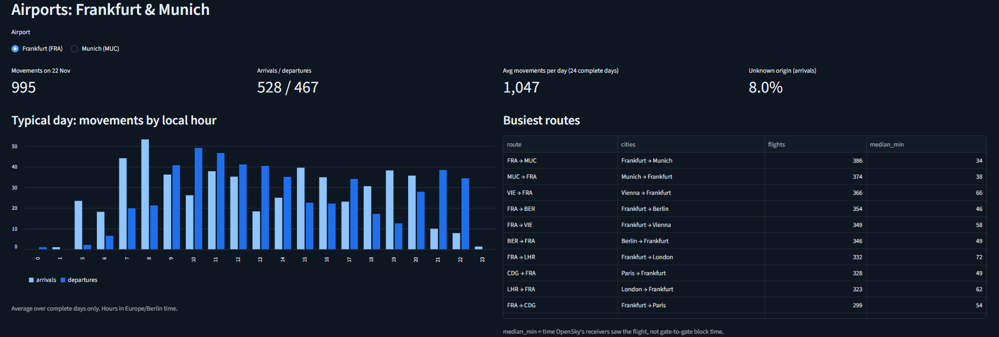

# ✈️ Flight Operations Data Pipeline

**Live ADS-B data from the OpenSky Network → Airflow → Azure Blob Storage (Azure SDK, run locally on Microsoft's Azurite emulator) → dbt (models + tests) → dashboard. Runs in Docker; CI/CD with GitHub Actions.**

[](https://github.com/chiranjeev89/opensky-flight-pipeline/actions/workflows/ci.yml)
   



---

## 1. Problem

Airports and airlines need reliable, up-to-date traffic data. Air traffic data is public: every airliner broadcasts its position over ADS-B. Raw, though, it is hard to use. It arrives as an unlabelled array of 17 numbers per aircraft, with missing positions, padded callsigns and SI units. It changes every few seconds, and the API has a daily credit budget.

I worked 2+ years on predictive modelling of aircraft systems, and models like that need data that is **reliable, tested and on time**. So this project answers an engineering question rather than an analysis one:

> *Can I build a pipeline that collects live flight data around the clock, never publishes bad data, stays inside the free API budget, and proves its own health with numbers?*

The questions the data then answers:
- How many aircraft are over Germany each hour, and when is the peak?
- **How many flights use Frankfurt (FRA) and Munich (MUC) each hour and day, and what are their busiest routes?**
- What share of observations are climb, cruise, descent or on the ground?
- Which registration countries fly over Germany?
- **How healthy is the pipeline itself?** (completeness, latency, data quality)

## 2. Architecture



Static image for slides/LinkedIn: [docs/img/architecture.png](docs/img/architecture.png)

| Layer | Tech | Why (full reasoning in [docs/DECISIONS.md](docs/DECISIONS.md)) |
|---|---|---|
| Ingest | Python + `requests`, OAuth2 client credentials | Only auth flow OpenSky supports since March 2026 |
| Orchestration | Apache Airflow 3 | Retries, scheduling and a UI; used in most German data-engineering roles |
| Storage | Azure Blob (Azure SDK) on Microsoft's Azurite emulator, Parquet, Hive partitions | Same code and API as Azure Storage at €0; switching to a real storage account is one line in `.env` ([D-003](docs/DECISIONS.md)) |
| Transform | dbt + DuckDB | SQL with lineage, tests and docs; €0 compute; runs in CI |
| Serving | Streamlit | Python, in git, one container |
| Packaging/CI/CD | Docker Compose, GitHub Actions, GitHub Container Registry | One-command start; every push tested; every release published as images |

## 3. Measure: what I track, and how

The pipeline measures itself. Every ingest run writes a metrics row (`raw/runs/`), and two dbt marts turn those rows into numbers:

| Metric | Source | Definition |
|---|---|---|
| **Schedule completeness** | `fct_pipeline_health` | distinct 10-minute slots with a landed run ÷ 144 per day (capped at 100%) |
| **API latency avg / p95** | `fct_pipeline_health` | time for `/states/all`, measured in the task |
| **Credits remaining** | `fct_pipeline_health` | from the `X-Rate-Limit-Remaining` header |
| **Rows / storage per day** | `fct_pipeline_health` | state vectors and MB of Parquet |
| **% missing position / callsign** | `fct_data_quality` | quality of the raw feed |
| **Duplicates removed** | `fct_data_quality` | raw rows − cleaned rows |
| **Data tests passed** | `dbt build` | 49 data tests (38 generic + 11 singular) on every hourly run |
| **Airport movements per day** | `fct_airport_daily` | arrivals + departures at FRA and MUC, with % unknown origin/destination |
| **Airport data freshness** | `assert_airport_data_is_fresh` | newest complete airport day ≤ 3 days old (warning) |
| **Airport day completeness** | `fct_airport_daily.is_complete_day` | arrivals and departures each ≥ 50% of the airport's median day; incomplete days are flagged and excluded from averages (BUG-010) |
| **Credit budget** | design | `/states`: 144 runs × 2 credits = **288/day = 7% of quota**; `/flights`: 4 calls/day (separate bucket) |

Reproduce every number with one command: `make measure` (runs [scripts/measure_pipeline.py](scripts/measure_pipeline.py)).

## 4. Results (live, 30 Oct – 23 Nov 2026)

Collected on a laptop over 3.5 weeks; it was switched off on some days (college, travel), so live positions have gaps. Airport data has none, because those days are re-fetched later (catch-up). Reproduce with `make measure`.

| Metric | Value |
|---|---|
| Days with live position data | **19** (3 full 24-hour days at 100% schedule completeness) |
| Ingest runs landed | **1,540** (1 failed in 3.5 weeks) |
| Aircraft positions (state vectors) stored | **468,417** (~290 aircraft per snapshot, up to ~560 at peak) |
| Unique aircraft seen | **12,980** |
| Peak airborne aircraft in one hour | **1,346** (1 Nov, 15:00 German time) |
| Storage used | **36 MB** Parquet for all positions |
| OpenSky API latency | avg **491 ms**, typical daily p95 **~665 ms** (worst day 3.0 s) |
| Transforms published | **281** hourly builds; every one passed all tests before publishing |
| Data quality | 0% missing positions · 1.15% missing callsigns · 0 duplicates · **106 transponder glitches** (0.023%) quarantined |
| Flight phase mix | cruise 39% · descent 19% · ground 17% · climb 13% · level (low) 11% |
| **Frankfurt (FRA)** | **25,126** movements in 24 days · avg **1,047/day** (959 – 1,169) |
| **Munich (MUC)** | **18,541** movements in 24 days · avg **773/day** (687 – 887) |
| Routes observed | **1,271** routes, **38,707** flights · busiest **FRA ⇄ MUC** (386 / 374), VIE → FRA (366) |
| FRA hub pattern | arrivals peak 07:00–08:00, departure waves follow ~2 h later (German time) |
| dbt build | **63 / 63 PASS** (13 models, 1 seed, 49 tests) |
| Unit tests | **31 passed** (+1 DAG import test in the CI Docker job) |



### Tested by real life (robustness)

| What happened | What the pipeline did |
|---|---|
| Laptop off for days, battery died, Windows Update restarts | Resumed with `start.bat`; no corruption, no duplicates (deterministic file names); gaps visible as lower completeness, not hidden |
| **Transponder glitches** (2 aircraft > 750 kt, BUG-009) | First blocked every publish; redesigned to quarantine single bad rows and block only systemic errors. 106 glitches caught since |
| **OpenSky sent incomplete airport days** (8–12 Nov: FRA 1 arrival instead of ~540, BUG-010) | Volume check against each airport's median now flags such days; every run re-fetches the last 3 days. All 4 days repaired, and 2 "normal-looking" days gained ~15% more flights |
| Code updated while containers ran old image | One task failed with ImportError; Airflow retried after the rebuild and succeeded |
| Injected impossible snapshot (98,000 ft, 900 m/s, lat/lon swapped) | Systemic-glitch test FAILS → 18 downstream nodes SKIPPED → nothing published, dashboard kept the last good data |

## 5. Why it works

1. **Bad data cannot reach the dashboard.** `publish` runs only after `dbt build` succeeds. The negative test above proves it: one corrupt row stopped the whole publish, and the dashboard kept the last good data.
2. **Retries can't duplicate data.** Blob names are deterministic (`states_<snapshot_time>.parquet`) and uploads overwrite, and staging also dedupes on `(icao24, snapshot_ts)`.
3. **Raw data is never modified (ELT).** A cleaning bug is fixed by re-running dbt. That matters because a live API can't be re-fetched later.
4. **It fails loudly, not silently.** A fixed Parquet schema means a type change errors. Physical-limit tests (altitude, speed, bounding box) catch the classic swapped-index bug, and 429 is treated as "skip", not "retry and spam".
5. **It respects the budget by design.** The bounding box was chosen for its credit tier (≈71 sq° → 2 credits), and a unit test fails if someone widens it.
6. **No lock fights.** dbt writes `warehouse.duckdb` and the dashboard reads an atomically swapped `serving.duckdb`.
7. **Airport data that can be re-fetched is re-fetched.** Unlike live positions, OpenSky's flight history is available later, so the daily airport DAG uses `catchup` and re-fetches the last 3 days on every run: days missed while the laptop was off, or published late by OpenSky (BUG-010), fill in automatically.
8. **"Green" is not the same as "complete".** A volume check against each airport's median day flags days where the source sent far too little data, instead of quietly averaging them in.

## 6. What I'd improve

| Next step | Why |
|---|---|
| Incremental dbt models by `snapshot_hour` | Staging rescans all Parquet each hour, the first scaling limit ([FAILURE.md](docs/FAILURE.md)) |
| Sync only the last N days of partitions | `list_blobs` slows down as files pile up (~52k/year) |
| Alerts via `on_failure_callback` → Slack/email | Failures are visible only in the Airflow UI today |
| Managed Identity / SAS token instead of an account key | The connection string gives full account access ([THREAT.md](docs/THREAT.md) T-03) |
| gitleaks + Actions pinned by SHA in CI | Supply-chain and secret hygiene |
| Trajectory-based flight phases (1-min polling, ≤25 sq° box around FRA = 1 credit) | Snapshot phases can misclassify single noisy points |
| Full airport reference data (OurAirports) instead of the 54-airport seed | Every route gets a readable name, not only the common ones |
| Airport punctuality (compare with published schedules) | ADS-B gives actual times only; delays need schedule data |
| Real Azure deployment (Container Apps + Storage) | Moves cloud from emulated to production |

## 7. Live demo and CI/CD

- **Live demo:** _add your Streamlit Community Cloud link here_ — a frozen snapshot of the real results (3.4 MB, marts only, built with `scripts/make_demo_db.py`). No pipeline runs there, so it costs nothing and spends no API credits.
- **CI** (`.github/workflows/ci.yml`, every push): ruff lint → 31 unit tests (OpenSky mocked) → dbt build with all 49 data tests on synthetic data → Docker build + Airflow DAG import check.
- **CD** (`.github/workflows/release.yml`, every `v*` tag): builds the Airflow and dashboard images and publishes them to GitHub Container Registry:
  ```bash
  docker pull ghcr.io/chiranjeev89/opensky-flight-pipeline-dashboard:latest
  docker pull ghcr.io/chiranjeev89/opensky-flight-pipeline-airflow:latest
  ```

## 8. Run it

**Prerequisites:** Docker Desktop, Git, a free [OpenSky account](https://opensky-network.org) → Account → *API client* (client id + secret).

```bash
git clone https://github.com/chiranjeev89/opensky-flight-pipeline && cd opensky-flight-pipeline
cp .env.example .env            # paste OPENSKY_CLIENT_ID / OPENSKY_CLIENT_SECRET
docker compose up -d --build    # Airflow  http://localhost:8080  (no login locally)
                                # Dashboard http://localhost:8501
```
The first ingest lands within 10 minutes, and the first dashboard data appears after the next `:05` past the hour. Airport arrivals/departures appear after the daily 06:15 UTC run (it also fills in all earlier days automatically).

**Without Docker or credentials (2 minutes):**
```bash
pip install -r requirements-dev.txt -r requirements-dashboard.txt
make sample && make dbt && make measure
SERVING_DB_PATH=data/lake/serving.duckdb streamlit run dashboard/app.py
```

**Stop, resume, where the data is stored:** see [docs/OPERATIONS.md](docs/OPERATIONS.md).

**Use real Azure instead of Azurite:** put your storage account connection string in `AZURE_STORAGE_CONNECTION_STRING` in `.env`. No code changes are needed.

## 9. Repo map

```
src/flightpipe/     opensky_client.py · transform.py · storage.py · config.py   (all logic, unit-tested)
airflow/dags/       opensky_ingest.py · flight_transform.py · airport_flights_daily.py   (wiring only)
dbt/                models/staging · models/marts · seeds/airports.csv · tests · macros
dashboard/app.py    Streamlit
scripts/            generate_sample_data.py · measure_pipeline.py · inject_bad_snapshot.py · make_demo_db.py
demo/               serving_demo.duckdb (frozen results for the public demo)
tests/              pytest (HTTP mocked)
docs/               engineering record (below)
```

## 10. Engineering record

Every decision in this repo is written down so I can defend it at a whiteboard:

| Question a reviewer asks | Answered in |
|---|---|
| Why X instead of Y? | [DECISIONS.md](docs/DECISIONS.md), [ALTERNATIVES.md](docs/ALTERNATIVES.md) |
| What if someone acts maliciously? | [THREAT.md](docs/THREAT.md), [CONSTRAINTS.md](docs/CONSTRAINTS.md) |
| What data structure, and why? | [DATA.md](docs/DATA.md), [FLOW.md](docs/FLOW.md) |
| Where does it fail? | [FAILURE.md](docs/FAILURE.md), [TESTING.md](docs/TESTING.md), [ROLLBACK.md](docs/ROLLBACK.md) |
| What is it for, and for whom? | [PRD.md](docs/PRD.md) |
| How should the dashboard look? | [DESIGN_SYSTEM.md](docs/DESIGN_SYSTEM.md) |
| One-page brief | [defense/DEFENSE-flight-pipeline.md](docs/defense/DEFENSE-flight-pipeline.md) |

Also: [OPERATIONS](docs/OPERATIONS.md) · [HANDOVER](docs/HANDOVER.md) · [ASSUMPTIONS](docs/ASSUMPTIONS.md) · [DEPENDENCIES](docs/DEPENDENCIES.md) · [features/](docs/features) · [bugs/](docs/bugs)

---
Data: © [The OpenSky Network](https://opensky-network.org), used under their terms for non-commercial research. *Matthias Schäfer et al., "Bringing Up OpenSky: A Large-scale ADS-B Sensor Network for Research", IPSN 2014.*
Author: Chiranjeev Sharma · M.Sc. Data Science · B.E. Aerospace Engineering
